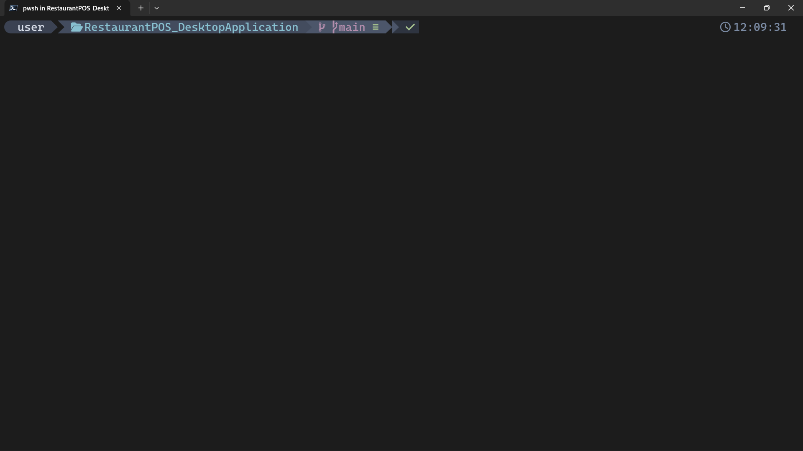

# PowerCLI — Professional PowerShell CLI

A complete, self-contained PowerShell environment for Windows developers:

- **Prompt**: Oh-My-Posh with a custom **Nord** theme — muted, eye-friendly colours
- **Right-aligned clock** that stays on the right edge (even after a terminal resize)
- **Nerd Font** (CaskaydiaCove NF) for crisp icons
- **41 functions + 21 aliases** for navigation, git, .NET, Docker and general tasks
- **Idempotent installer** — one command on a fresh machine
- **0 errors** on load (PS 5.1 and PS 7)

```
 user │ 📁 my-project │ ⎇ master ↑1 ✎ ?1 ~2 │ ✔          🕐 13:20:48
 slate   ice blue        mauve  grn  amb    ice   dim
                        ↑ left side                    ↑ right edge
```



The clock is pinned to the right edge of the terminal while the text cursor
stays on the left, so typing is never disturbed by it.

---

## Install (one command)

```powershell
iex ((irm https://raw.githubusercontent.com/EngMohamedNowar/PowerCLI/main/tools/powershell/Install-CLI.ps1).TrimStart([char]0xFEFF))
```

Or from a clone:

```powershell
git clone https://github.com/EngMohamedNowar/PowerCLI.git
cd PowerCLI
.\tools\powershell\Install-CLI.ps1
```

Then **close and reopen Windows Terminal** (required for the font).

### What the installer does

1. Sets the execution policy to `RemoteSigned`
2. Installs **Git** + **PowerShell 7** via `winget` (if missing)
3. Downloads and registers the **CaskaydiaCove NF** Nerd Font (per user, no admin)
4. Patches Windows Terminal: font + soft Nord palette + PowerShell 7 as default
5. Writes the profile files (PS 5.1 and PS 7)
6. Verifies everything

> **Important:** The Nerd Font icons (📁 ⎇ 🕐 etc.) only render in a terminal
> that uses the Nerd Font. The installer sets Windows Terminal's font to
> `CaskaydiaCove NF` automatically. If you use a different terminal (VS Code,
> ConEmu, etc.), set its font to `CaskaydiaCove NF` manually, or the icons
> will appear as empty boxes.
>
> The `PowerShell 7.7.0` startup banner is suppressed automatically by the
> profile (via `Clear-Host` on first load) and by Windows Terminal (via
> `-NoLogo` in the profile's commandline).

> **OneDrive note:** if your Documents folder is redirected to OneDrive
> (e.g. `C:\Users\KING1\OneDrive\Documents\...`), the installer detects this
> automatically via `$PROFILE` and writes to the correct location. No manual
> copying needed.

### Installer options

| Flag | Effect |
|---|---|
| `-SkipTools` | don't touch winget (Git / PowerShell 7 already present) |
| `-SkipFont` | don't download / register the Nerd Font |
| `-ForceFont` | re-register the font even if already present |

The installer is **idempotent** — running it twice is safe.

---

## Run it

```powershell
status      # environment summary
psclihelp   # full command reference
```

---

## Command reference

### Navigation
| Command | Description |
|---|---|
| `mkcd <path>` | create a directory and enter it |
| `..` / `...` | up one / two levels |
| `psclihelp` | show the command reference |
| `status` | environment summary |

### Git
| Command | Description |
|---|---|
| `gs` | `git status -sb` |
| `gb` | `git branch -v` |
| `glog` | `git log --oneline --graph --decorate` |
| `gd` / `gadd` | `git diff` / `git add` |
| `gcommit <msg>` | `git commit -m` |
| `gac <msg>` | `git add --all` + `git commit -m` in one go |
| `gpull` / `gpush` | `git pull --rebase` / `git push` |
| `gco <branch>` | `git checkout` |
| `gnew <branch>` | create and switch to a new branch |
| `groot` | jump to the repository root |
| `gst` | `git stash` |

### Build / Test (.NET)
| Command | Description |
|---|---|
| `build [proj]` | `dotnet build` |
| `run [proj]` | `dotnet run` |
| `watch [proj]` | `dotnet watch` |
| `test [proj]` | `dotnet test` |
| `restore [proj]` | `dotnet restore` |
| `publish [proj]` | `dotnet publish` |
| `clean [proj]` | `dotnet clean` |
| `b` / `br` / `t` / `rw` | build / run / test / restore |

### Docker
| Command | Description |
|---|---|
| `dps` | `docker ps` |
| `dpa` | `docker ps -a` |
| `dc <args>` | `docker compose <args>` |
| `docker-clean` | prune everything |
| `docker-stop-all` | stop all containers |
| `dp` | alias for `dps` |

### Database / SQL
| Command | Description |
|---|---|
| `db-query <sql>` | run a SQL query (localhost,1433) |
| `db-list` | list databases |

### General
| Command | Description |
|---|---|
| `mkcd <path>` | create a directory and enter it |
| `ff <name>` | find files by name (recursive) |
| `grep <pattern>` | search file contents |
| `json <file>` | pretty-print JSON |
| `ports [port]` | show listening ports |
| `killport <port>` | kill the process on a port |
| `ipinfo` | local + public IP |
| `now` / `utc` | timestamps |
| `history-search <term>` | search command history |
| `reload-profile` | re-apply the profile |

---

## Colour palette (Nord)

| Where | Hex |
|---|---|
| terminal background | `#1C1C1C` (soft charcoal, not pure black) |
| terminal foreground | `#D8DEE9` (off-white, not pure white) |
| cursor | `#88C0D0` |
| selection | `#3B4252` |
| user segment | bg `#3B4252` / fg `#D8DEE9` |
| path segment | bg `#434C5E` / fg `#88C0D0` |
| branch name | `#B48EAD` |
| ahead / behind | `#A3BE8C` / `#BF616A` |
| dirty indicators | `#EBCB8B` |
| stash count | `#88C0D0` |
| exit-code check | `#A3BE8C` / `#BF616A` |
| clock | `#7C8CA5` |

---

## Files

```
PowerCLI/
├── README.md                          ← this file
├── README-CLI.md                      ← detailed command reference
├── SETUP-CLI.md                       ← step-by-step reproduction guide
└── tools/powershell/
    ├── PowerCLI.ps1                   ← the CLI (632 lines)
    ├── Install-CLI.ps1                ← idempotent installer
    └── themes/
        ├── powercli.omp.json          ← the prompt theme (Nerd Font glyphs)
        └── powercli-plain.omp.json    ← glyph-free fallback theme
```

`tools/powershell/` is **self-contained** — copying just that folder to a new
machine and running `Install-CLI.ps1` is enough.

---

## Problems Fixed

This CLI was built to solve real problems encountered on a Windows dev machine.
Each one is documented so you know *why* the code is shaped the way it is.

### 1. Git branch not showing in the traditional CLI

The default PowerShell prompt does **not** show the current git branch. You had
to run `git status` or `git branch` every time. PowerCLI's prompt shows the
branch, ahead/behind counts, modified files and stash count at a glance:

```
⎇ master ↑1 ✎ ?1 ~2
```

### 2. `PowerShell 7.7.0` startup banner

When opening PowerShell 7, the banner `PowerShell 7.7.0` + copyright line
printed on every launch. Fixed two ways:

- Windows Terminal `commandline` now includes `-NoLogo`
- The profile calls `Clear-Host` (via ANSI escape) on first load, so even
  `pwsh` opened from the Run dialog is clean

### 3. Icons showing as empty boxes `□`

Oh-My-Posh themes use Nerd Font glyphs. Without a Nerd Font installed, the
terminal renders them as empty boxes. Fixed by:

- Installing **CaskaydiaCove NF** (v3.5.1) per-user (no admin)
- Registering it in `HKCU\Software\Microsoft\Windows NT\CurrentVersion\Fonts`
- Setting Windows Terminal `profiles.defaults.fontFace = "CaskaydiaCove NF"`

### 4. Profile not found (`$PROFILE` points to OneDrive)

On machines where Documents is redirected to OneDrive, PowerShell's `$PROFILE`
points to `C:\Users\KING1\OneDrive\Documents\...` but hardcoded paths in
scripts pointed to `C:\Users\KING1\Documents\...`. Fixed by deriving every
path from `$PROFILE`:

```powershell
$profileDir   = Split-Path $PROFILE
$documentsDir = Split-Path $profileDir
$SharedDir    = Join-Path $documentsDir 'PowerShell'
```

Works on any machine, with or without OneDrive.

### 5. Clock not fixed on the right

Oh-My-Posh's right-aligned block renders inside the *same* prompt string,
leaving the text cursor sitting **after** the clock, so everything you typed
appeared over there. Fixed by rendering the clock ourselves with ANSI cursor
positioning, leaving the cursor where you are typing.

### 6. Clock wraps onto the next line after a resize

PSReadLine caches the prompt string and re-draws it on a resize, so the
clock's absolute column went stale and wrapped. Fixed with a 500 ms timer
that detects the width change and calls `Invoke-PoshPromptRepaint`, then writes
`ESC[1B ESC[2K ESC[1A` to clear any stale clock on the next line.

### 7. `iex (irm ...)` not working

`Invoke-Expression` cannot parse scripts with a BOM or `[CmdletBinding()]`.
Fixed by removing both from the installer and documenting the working one-liner:

```powershell
iex ((irm <url>).TrimStart([char]0xFEFF))
```

### 8. `Set-Alias: The AllScope option cannot be removed`

Redefining a built-in alias (like `cat`, `clear`, `gl`) with `-Scope Global`
throws because those aliases have the `AllScope` option. Fixed by using
`-Option AllScope` for every alias.

### 9. `Cannot validate argument on parameter 'Function'`

Several key bindings (`CopyOrCancel`, `AddToHistory`, `Ctrl+Space`) are not
valid in older PSReadLine versions. Fixed by binding each key individually
inside a try/catch so one failure never blocks the rest.

### 10. `$Error` polluted on every keystroke

`-ErrorAction SilentlyContinue` still writes to `$Error`. `Ignore` does not.
Native git stderr is recorded in `$Error` even with `2>$null`. Fixed by using
`-ErrorAction Ignore` everywhere and routing native git calls through
`cmd /c "... 2>nul"`.

### 11. Oh-My-Posh module not registered

The `oh-my-posh` PowerShell module is not in `$PSModulePath` on a fresh
install. Fixed by using `oh-my-posh init pwsh` which emits a ready-to-run
init script — no module registration needed.

### 12. Stray empty git repo in the parent folder

`D:\CarRentalApp\.git` was an empty repo (0 objects, 0 refs, no remote) from
an accidental `git init`. It made `git status` show `?? C4_CarRentalApp/`
instead of the real repo's status. `groot` now skips empty wrapper repos
automatically, and the stray `.git` was removed.

### 13. Console shows `?` instead of symbols

The console codepage was IBM437. Fixed by forcing UTF-8:
`[Console]::OutputEncoding = [System.Text.Encoding]::UTF8`.

### 14. Users see weird symbols (empty boxes) in the prompt

Users who ran PowerCLI in a terminal that was **not** using a Nerd Font saw the
prompt icons (, , , , ...) as empty boxes / tofu. The old code always
loaded the glyph theme, so a missing or unselected font guaranteed broken output.

Fixed with automatic detection at load time:

- `Test-PowerCLINerdFont` checks — cheaply, with **no `Add-Type`** (compiling
  C# costs ~470 ms, which would blow the 500 ms profile budget):
  1. `POWERCLI_PLAIN` / `POWERCLI_FORCE_GLYPHS` overrides
  2. Windows Terminal `settings.json` `fontFace` (authoritative when
     `WT_SESSION` is set)
  3. the per-user / system font registry for any installed Nerd Font
- If a Nerd Font is usable → the glyph theme loads as before.
- If not → the new `powercli-plain.omp.json` loads instead: same Nord palette
  and git status, but only plain Unicode (uses `.Ref` instead of `.HEAD`,
  because `.HEAD` injects the `U+E0A0` branch icon).
- The right-hand clock drops its `U+F017` icon when no Nerd Font is present.

Result: **zero tofu boxes in any terminal**, with the full experience kept for
terminals that do have the font.

---

## Toggles

| Variable | Effect |
|---|---|
| `$env:POWERCLI_NO_CLOCK = '1'` | hide the clock |
| `$env:POWERCLI_NO_OMP = '1'` | use the built-in native prompt instead of Oh-My-Posh |
| `$env:POWERCLI_PLAIN = '1'` | force the glyph-free theme (no Nerd Font icons) |
| `$env:POWERCLI_FORCE_GLYPHS = '1'` | force the Nerd Font theme even if detection says otherwise |

Apply changes without restarting:

```powershell
reload-profile
```

---

## Troubleshooting

| Symptom | Fix |
|---|---|
| Prompt shows empty boxes `□` | Nerd Font missing — restart Windows Terminal after install. The profile now auto-detects this and loads the plain theme, so boxes should not appear; if they do, set `$env:POWERCLI_PLAIN='1'` and run `reload-profile` |
| `. $PROFILE` → "not recognized" | run `Install-CLI.ps1` |
| Console shows `?` instead of symbols | console codepage is 437 — the profile forces UTF-8 |
| Terminal settings ignored | `settings.json` must be UTF-8 **without** BOM |
| No autocomplete suggestions | output is redirected (CI, pipes) — expected |

---

## License

Personal project. Feel free to fork and adapt.
